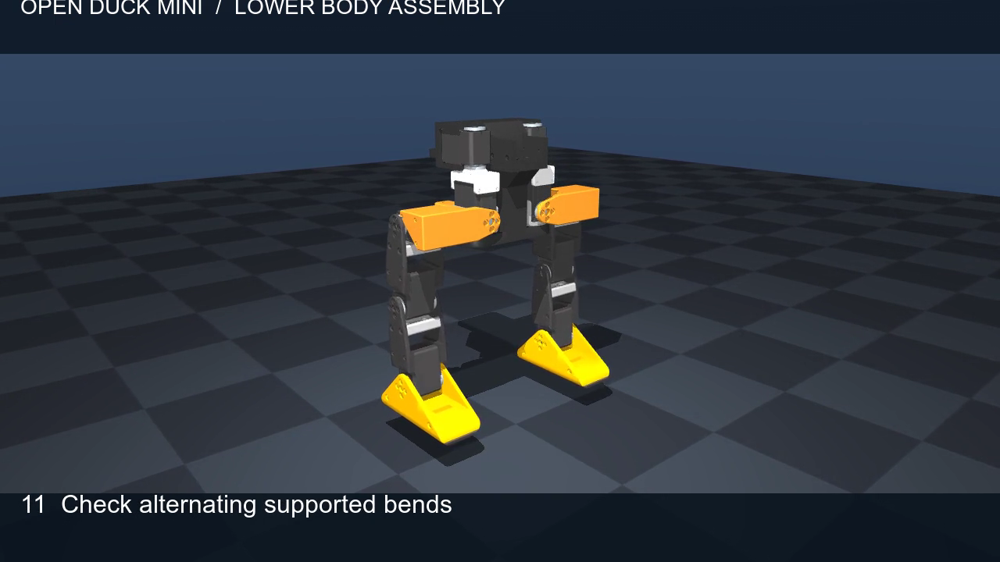
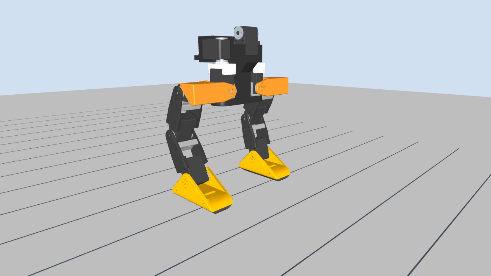

# brown-duck

Our club's build of the [Open Duck Mini v2](https://github.com/apirrone/Open_Duck_Mini): a ~42 cm
bipedal duck robot with 14 Feetech STS3215 servos, a Raspberry Pi Zero 2W and a BNO055 IMU.
Goal: a stock v2 **walking by early December**, then our own design.

## Next lab: build and test one leg

Build the **left leg**, assign its five servo IDs, and try a small supported motion.
Start with the [leg lab worksheet](activities/leg-mechanism.md) for the parts list,
power setup, wiring, and build order.

[](docs/videos/leg-assembly.mp4)

The video shows both legs, hips, and inner pelvis. The
[assembly guide](Open_Duck_Mini/docs/assembly_guide.md) has the exact hardware steps.

### Set up and preview

From the repository folder, install [Miniconda](sim/INSTALL_CONDA.md) if needed, then run:

```bash
git submodule update --init --recursive
conda env create -f sim/environment.yml  # skip if it already exists
conda activate brown-duck
```

Open the [lower-body URDF](sim/model/lower_body.urdf) walking preview:

```bash
mjpython sim/urdf_walk.py  # macOS
python sim/urdf_walk.py    # Linux / Windows
```

[](docs/videos/urdf-walk.mp4)

The viewer shows a supported IK gait. It does not drive physical servos or test
balance. See [simulator setup](sim/README.md) for a virtual environment or a
no-window check.

### Connect and test the left leg

1. [Check parts and power](activities/leg-mechanism.md#1-check-parts-and-power).
   Use a supply that matches **every servo's rated voltage**; USB is for data.

2. [Assign IDs one servo at a time, then daisy chain](activities/leg-mechanism.md#2-assign-ids-then-daisy-chain).
   Power off before changing cables. The left leg uses IDs **20–24**.

3. [Assemble and test a small knee movement](activities/leg-mechanism.md#3-assemble-and-check-motion).
   Support the hip and stop if the mechanism binds.

## After both legs and hips are assembled

Follow the [lower-body worksheet](activities/leg-mechanism.md#after-both-legs-are-assembled-calibration-and-exploration)
after adding the right leg (IDs **10–14**):

1. [Calibrate all ten joints with a live terminal view](activities/leg-mechanism.md#1-calibrate-the-assembled-lower-body).

2. [Control one motor at a time](activities/leg-mechanism.md#2-control-and-observe-one-motor-at-a-time),
   then have students record each joint's direction and limits.

3. [Try a foot target with IK, then watch the gait](activities/leg-mechanism.md#3-try-ik-then-the-gait).

Keep the lower body supported during physical tests. The gait currently runs in
MuJoCo; model angles need a calibrated hardware mapping.

## Find the details

- [Archived servo lab](activities/servo-lab.md): original ID, status, and two-servo commands.
- [Daisy-chain guide](hardware/SERVO_DAISY_CHAIN.md): mixed gear ratios and wiring help.
- [Print list](hardware/PRINT_LIST.md) and [parts list](hardware/BOM.md).
- [Simulator guide](sim/README.md): setup and troubleshooting.
- [Open Duck Mini hardware](Open_Duck_Mini/README.md): CAD and upstream build documents.

## Join the robotics club e-board

Interested in an e-board position? Fill out the
[e-board application form](https://docs.google.com/forms/d/e/1FAIpQLSfT_RuMOdUsZTs073NgPWlHB3cXlm2mz7AZDz0dPcLtar_VOw/viewform)
or scan the QR code:


## Links

- Upstream: [Open_Duck_Mini](https://github.com/apirrone/Open_Duck_Mini) (hardware),
  [Open_Duck_Playground](https://github.com/apirrone/Open_Duck_Playground) (RL training + sim),
  [Open_Duck_Mini_Runtime](https://github.com/apirrone/Open_Duck_Mini_Runtime) (code on the robot)
- [Open Duck Discord](https://discord.gg/UtJZsgfQGe)
- [tnkr.ai build guide](https://tnkr.ai/explore/docs/open-duck-mini/open-duck-mini-v2#home)
