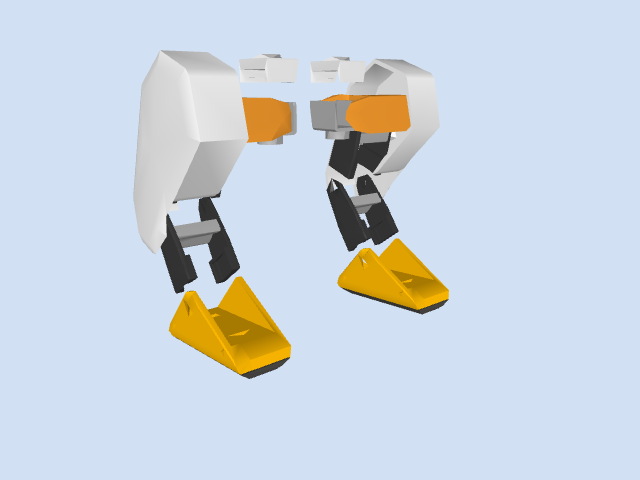

# brown-duck

Our club's build of the [Open Duck Mini v2](https://github.com/apirrone/Open_Duck_Mini): a ~42 cm
bipedal duck robot with 14 Feetech STS3215 servos, a Raspberry Pi Zero 2W and a BNO055 IMU.
Goal: a stock v2 **walking by early December**, then our own design.

## Today's meeting: servo lab

Work in **3–4 groups**. Each group gets **two Feetech STS3215 servos, one Waveshare bus servo
adapter, a suitable servo power supply, and a USB cable**. Bring a laptop with this repo and the
`brown-duck` conda environment. The goal is to give each servo a unique ID, read its status,
command a small angle, then connect both on one bus. After that, try the two-servo simulation and
mirror it to the real servos.

### 1. Get ready

```bash
git clone --recursive https://github.com/soujanya957/brown-duck.git
cd brown-duck
conda env create -f sim/environment.yml
conda activate brown-duck
```

Already cloned? Run `git pull && git submodule update --init`, then
`conda env update -f sim/environment.yml --prune` and `conda activate brown-duck`.
No conda yet? Follow [sim/INSTALL_CONDA.md](sim/INSTALL_CONDA.md), or the
[venv instructions](sim/README.md#option-b-venv). Run all commands below from `brown-duck/`.

### 2. Wire and find the port

Power **off** while plugging servos in. Connect the power supply to the adapter's servo power
input with the correct polarity and voltage for your exact STS3215 variant; USB alone does not
power the servos. Connect USB to the laptop. Keep the servo horns clear of fingers and loose
cables. Use `python -m serial.tools.list_ports` to find the board port (for example
`/dev/tty.usbmodem...`, `/dev/ttyUSB0`, or `COM3`). Replace `PORT` below with your actual port.

### 3. One servo at a time: ID, status, angle

**Only one servo may be connected while changing an ID.** New servos often share ID 1. With the
first servo connected and powered, check its current ID, then assign 1 if needed. Disconnect
power, swap in the second servo, and assign it ID 2. Try `OLD=1` for a new servo; replace it with its current ID if it was configured before:

```bash
python sim/servo_lab.py status --port PORT --ids OLD
python sim/servo_lab.py set-id --port PORT --old-id OLD --new-id 2
python sim/servo_lab.py status --port PORT --ids 2
```

For the first servo, change `--new-id 2` to `--new-id 1` if its current ID is not 1.
If it is already ID 1, leave it alone. For the second, `OLD` is usually 1. Power
cycle after the ID change. Label the servos **1** and **2**. With just one connected, try a small
position command (degrees relative to the servo's factory center):

```bash
python sim/servo_lab.py angle --port PORT --id 2 --degrees 10
python sim/servo_lab.py status --port PORT --ids 2
```

Remove any horn or load before commanding a position: a servo can move to its factory center.
The demo limits angle commands to ±30°. Do not force a powered servo by hand.

The STS3215 **1:147, 1:191 and 1:345** variants all use the same 4096-tick output position scale,
so the requested angle does **not** get multiplied by the gear ratio. The ratio changes the
mechanical speed and torque. To label what is on the bus and choose a slower command speed:

```bash
python sim/servo_lab.py status --port PORT --ids 1 2 --gear-ratios 147 345
python sim/servo_lab.py angle --port PORT --id 1 --degrees 10 --gear-ratio 147 --speed 40
```

`--gear-ratio`/`--gear-ratios` label the motors in the output; `--speed` sets the servo's motion
speed (default 60, allowed 1–200). The usual STS3215 labels are **C046 = 1:147**,
**C044 = 1:191**, and **C001 = 1:345**. Some high-torque units, such as **C018/C047**, are
**12 V** versions. Read the voltage on each actual label: **do not daisy-chain 7.4 V and 12 V
servos on one powered bus**. Give the 12 V motor its own suitable board/power supply for this lab.

### 4. Daisy chain and compare sim with hardware

Power off, connect both servos on the same bus with their separate IDs, then power on:

```bash
python sim/servo_lab.py status --port PORT --ids 1 2
```

First run the two-servo simulation alone. On macOS use `mjpython`; on Linux and Windows use
`python` (Windows path: `sim\servo_lab.py`):

```bash
mjpython sim/servo_lab.py demo                  # macOS, sim only
mjpython sim/servo_lab.py demo --port PORT --ids 1 2  # macOS, sim + hardware
```

For mixed ratios, add `--gear-ratios 147 191` (in the same order as `--ids 1 2`). You can
also set separate motion speeds with `--speeds 40 60`:

```bash
mjpython sim/servo_lab.py demo --port PORT --ids 1 2 --gear-ratios 147 191 --speeds 40 60
```

On Linux/Windows, replace `mjpython` with `python`. Click the viewer, then use **←/→** for servo
1 and **↑/↓** for servo 2. Each press changes its target by 5°, up to ±30°. In hardware mode,
those same relative commands go to the two physical servos, starting from their measured
positions when the viewer opens. Keep both motors free to turn.

**Try to explain:** Why must IDs differ on one bus? Which values in `status` are measurements,
and which command sets a target? What happens to the sim when a hardware command fails?

The full walking duck sim is still available: [sim/README.md](sim/README.md).

### 5. Minimal prints for one leg

For a first **left leg mechanism** (hip, shin and foot), print these parts from
[`Open_Duck_Mini/print/`](Open_Duck_Mini/print/). This is **14 printed pieces**, plus the servos,
horns, screws and bearings needed for assembly. The [full print list](hardware/PRINT_LIST.md)
covers the complete duck.

| Piece | Qty |
|---|---:|
| [`roll_motor_top.stl`](Open_Duck_Mini/print/roll_motor_top.stl), [`roll_motor_bottom.stl`](Open_Duck_Mini/print/roll_motor_bottom.stl) | 1 each |
| [`left_roll_to_pitch.stl`](Open_Duck_Mini/print/left_roll_to_pitch.stl), [`left_cache.stl`](Open_Duck_Mini/print/left_cache.stl) | 1 each |
| [`knee_to_ankle_left_sheet.stl`](Open_Duck_Mini/print/knee_to_ankle_left_sheet.stl), [`knee_to_ankle_right_sheet.stl`](Open_Duck_Mini/print/knee_to_ankle_right_sheet.stl), [`leg_spacer.stl`](Open_Duck_Mini/print/leg_spacer.stl) | 2 each |
| [`foot_top.stl`](Open_Duck_Mini/print/foot_top.stl), [`foot_side.stl`](Open_Duck_Mini/print/foot_side.stl), [`foot_bottom_pla.stl`](Open_Duck_Mini/print/foot_bottom_pla.stl), [`foot_bottom_tpu.stl`](Open_Duck_Mini/print/foot_bottom_tpu.stl) | 1 each |

PLA at 15% infill for the rigid pieces; TPU at 40% for `foot_bottom_tpu.stl`. The
[assembly guide](Open_Duck_Mini/docs/assembly_guide.md) shows the foot, shin, thigh and hip order.

### 6. View only the sim legs

This command opens the **two legs from the duck model** with the trunk and head hidden. The hips
are fixed in place while the knees bend slowly, so it is a mechanism viewer rather than a walking
simulation. Run from the same `brown-duck` conda environment:

```bash
mjpython sim/legs.py  # macOS
python sim/legs.py    # Linux / Windows
```



To save a new still: `python sim/legs.py --preview docs/images/legs-only.png`.

## Folder map

- **`hardware/`**: what to buy and build
  - `BOM.md` / `BOM.csv`: parts list with prices (edit the CSV, regenerate with `make_bom_md.py`)
  - `PRINT_LIST.md`: checklist of all 36 STLs to print, linked into `Open_Duck_Mini/print/`
  - `ASSEMBLY.md`: one-page build order, rules, servo IDs, wiring pins
- **`activities/`**: meeting worksheets (`hardware.md`, `software.md`, `open-ended.md`);
  your ideas go in `activities/ideas/`, your projects in `activities/projects/`
- **`docs/images/`**: sim pictures (regenerate with `docs/render_screenshots.py`)
- **`sim/`**: walking simulator and the two-servo lab (`teleop.py`, `servo_lab.py`)
- **`Open_Duck_Mini/`** (git submodule, our fork of upstream): the hardware hub
  - `README.md`: CAD, bill of materials, build-guide links
  - `docs/print_guide.md`: what to 3D print and how
  - `docs/assembly_guide.md`: mechanical assembly
  - `docs/configure_motors.md`: setting servo IDs
  - `docs/open_duck_mini_v2_wiring_diagram.png`: wiring
  - `docs/sim2real.md`: going from sim to the real robot
  - `BEST_WALK_ONNX.onnx`, `BEST_WALK_ONNX_2.onnx`: trained walking policies

## Roadmap

| When | What |
|---|---|
| This week | servo lab: IDs, status, angles, daisy chain, sim + hardware |
| Next week | configure the robot IDs and start the first leg |
| Then | second leg, head, wiring |
| After that | walking on hardware |
| Early December | demo |

## Links

- Upstream: [Open_Duck_Mini](https://github.com/apirrone/Open_Duck_Mini) (hardware),
  [Open_Duck_Playground](https://github.com/apirrone/Open_Duck_Playground) (RL training + sim),
  [Open_Duck_Mini_Runtime](https://github.com/apirrone/Open_Duck_Mini_Runtime) (code on the robot)
- [Open Duck Discord](https://discord.gg/UtJZsgfQGe)
- [tnkr.ai build guide](https://tnkr.ai/explore/docs/open-duck-mini/open-duck-mini-v2#home)
