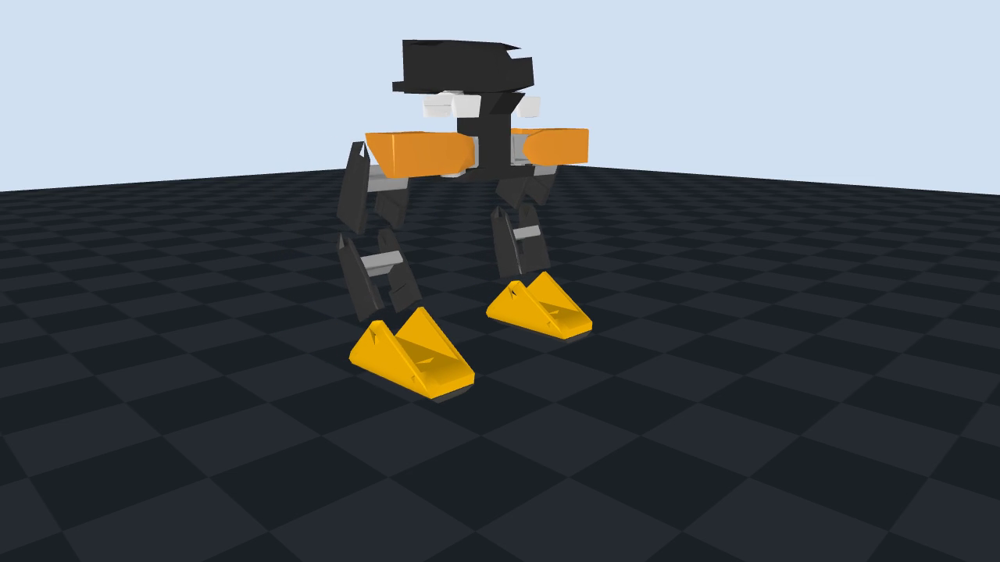

# brown-duck

Our club's build of the [Open Duck Mini v2](https://github.com/apirrone/Open_Duck_Mini): a ~42 cm
bipedal duck robot with 14 Feetech STS3215 servos, a Raspberry Pi Zero 2W and a BNO055 IMU.
Goal: a stock v2 **walking by early December**, then our own design.

## Join the robotics club e-board

Interested in an e-board position? Fill out the
[e-board application form](https://docs.google.com/forms/d/e/1FAIpQLSfT_RuMOdUsZTs073NgPWlHB3cXlm2mz7AZDz0dPcLtar_VOw/viewform)
or scan the QR code:


## Next lab: Open Duck Mini leg mechanism

Build **one left leg** from the printed foot, shin, thigh and hip parts. Set each servo's
robot ID separately, power the daisy chain through the Waveshare bus servo adapter,
and test a small supported stepping motion. Then explore how a two-link inverse
kinematics calculation turns a desired foot position into hip and knee angles.

Start with the [leg mechanism lab worksheet](activities/leg-mechanism.md). It has the
print checklist, wiring and power steps, assembly order, commands, and a simple gait
exercise. Bring the printed parts, matching-voltage servos, adapter, external servo
supply, USB cable, screws, horns and bearings. One leg can step while held or mounted;
walking across the floor needs the second leg and body.

[](docs/videos/leg-assembly.mp4)

[Watch the MuJoCo lower-body assembly animation](docs/videos/leg-assembly.mp4) · both legs,
hip mechanisms and the inner pelvis mount, without the exterior covers. The parts and
servo meshes come from the
[Open Duck Mini v2 model](Open_Duck_Mini/mini_bdx/robots/open_duck_mini_v2/robot.xml).
Use the [assembly guide](Open_Duck_Mini/docs/assembly_guide.md) for the exact hardware steps.

### Simple IK walking demo

[](docs/videos/ik-walk.mp4)

The [walking clip](docs/videos/ik-walk.mp4) comes from a small
[two-link IK controller](sim/ik_walk.py): each foot stays roughly in place during stance,
lifts during swing, and the supported pelvis moves forward. Run it in MuJoCo:

```bash
mjpython sim/ik_walk.py         # macOS viewer
python sim/ik_walk.py           # Linux / Windows viewer
python sim/ik_walk.py --check   # headless gait check
```

This is a kinematic lower-body demonstration. It sets joint positions and supports the
pelvis; balancing and real-servo calibration are separate steps.

The previous [servo lab](activities/servo-lab.md) remains available with the same commands
for ID setup, status, angle sweeps and the two-servo demo. The
[mixed-ratio daisy-chain guide](hardware/SERVO_DAISY_CHAIN.md) is also available.

## Folder map

- **`hardware/`**: what to buy and build
  - `BOM.md` / `BOM.csv`: parts list with prices (edit the CSV, regenerate with `make_bom_md.py`)
  - `PRINT_LIST.md`: checklist of all 36 STLs to print, linked into `Open_Duck_Mini/print/`
  - `ASSEMBLY.md`: one-page build order, rules, servo IDs, wiring pins
  - `SERVO_DAISY_CHAIN.md`: wiring and commands for mixed-ratio STS3215 servos
  - `SERVO_VARIANTS.md`: other STS3215 gear ratios and power requirements
- **`activities/`**: meeting worksheets (`leg-mechanism.md`, archived `servo-lab.md`,
  `hardware.md`, `software.md`, `open-ended.md`);
  your ideas go in `activities/ideas/`, your projects in `activities/projects/`
- **`docs/images/`**: sim pictures (regenerate with `docs/render_screenshots.py`)
- **`sim/`**: walking simulator, simple IK gait (`ik_walk.py`), the two-servo lab
  (`teleop.py`, `servo_lab.py`), and the
  `brown-duck-*` commands (`duck_tools.py`, installed by `pip install -e .`)
- **`Open_Duck_Mini/`** (git submodule, our fork of upstream): the hardware hub
  - `README.md`: CAD, bill of materials, build-guide links
  - `docs/print_guide.md`: what to 3D print and how
  - `docs/assembly_guide.md`: mechanical assembly
  - `docs/configure_motors.md`: setting servo IDs
  - `docs/open_duck_mini_v2_wiring_diagram.png`: wiring
  - `docs/sim2real.md`: going from sim to the real robot
  - `BEST_WALK_ONNX.onnx`, `BEST_WALK_ONNX_2.onnx`: trained walking policies

## Roadmap

| When | What |
|---|---|
| Previous lab | servo IDs, status, angles, daisy chain, sim + hardware |
| Next lab | configure leg IDs, assemble one leg, bench-step it and try simple IK |
| Then | second leg, head, wiring |
| After that | walking on hardware |
| Early December | demo |

## Links

- Upstream: [Open_Duck_Mini](https://github.com/apirrone/Open_Duck_Mini) (hardware),
  [Open_Duck_Playground](https://github.com/apirrone/Open_Duck_Playground) (RL training + sim),
  [Open_Duck_Mini_Runtime](https://github.com/apirrone/Open_Duck_Mini_Runtime) (code on the robot)
- [Open Duck Discord](https://discord.gg/UtJZsgfQGe)
- [tnkr.ai build guide](https://tnkr.ai/explore/docs/open-duck-mini/open-duck-mini-v2#home)
